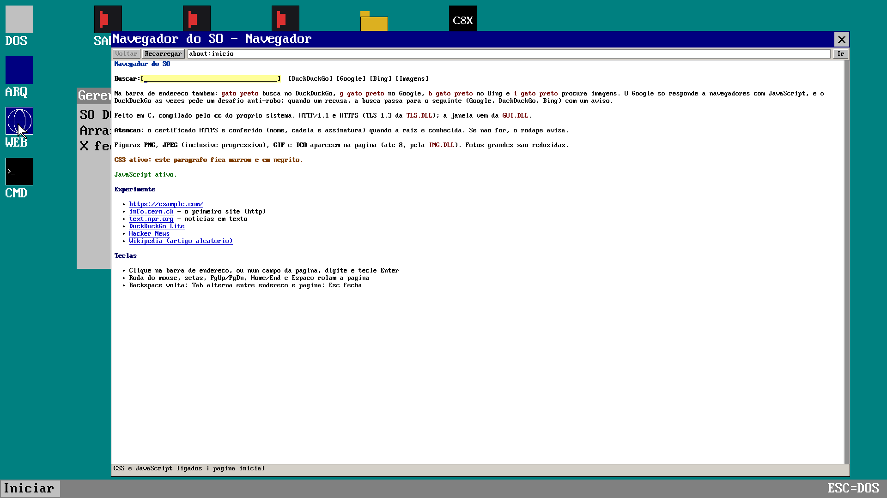

# SODOS

**Português** | [English](README.md)

Sistema operacional educacional de 64 bits (*long mode*), freestanding, escrito em C e assembly. Sobe direto pela BIOS (`os.img`); há também um caminho Multiboot legado para GRUB. Não depende de libc do Linux. Tem shell estilo DOS, desktop gráfico com janelas, FAT16 com subpastas, rede NE2000 com TCP/IP, servidor HTTP com API de controle remoto, navegador com TLS 1.3, compilador C/C++ próprio que roda dentro do sistema, visualizador de imagens, player de vídeo MJPEG e rasterizador de fontes TrueType.

O SODOS é projetado para ser o primeiro sistema operacional que pode ser comandado por uma API de inteligência artificial.



O desktop em 1920×1080 com o Navegador aberto e o Gerenciador atrás. A captura foi feita pelo próprio SO, com `GET /win/printscreen` na porta 8797.

O código está em `src13/`; este README fica na raiz do repositório.

O prompt aparece como `C:\>`; `C:` é um disco em RAM e `D:` é o `disk.img` (FAT16). Programas de usuário são arquivos `.EXE` no formato **SOX** — não são ELF, e o `hello.bin` de 32 bits que o boot ainda carrega não é executado.

## Um SO comandado por IA

A API HTTP da porta 8797 é a superfície de controle: um agente executa comandos, abre e fecha janelas, move o ponteiro, consulta as janelas abertas e captura a tela — sem teclado, mouse ou sessão humana.

O objetivo do projeto é ser leve o bastante para **rodar LLMs dentro do próprio SO** e, ao mesmo tempo, fazer tudo o que um sistema operacional convencional faz — arquivos, discos, rede, janelas, compilador, programas — gastando o mínimo de recursos.

O kernel é enxuto por construção:

| Item | Consumo |
|---|---|
| Kernel (`kernel.bin`) | ~193 KB |
| Imagem de boot (`os.img`) | ~198 KB |
| Heap do kernel | 2 MB fixos (`0xA80000`–`0xC7FFFF`) |
| Heap de usuário | do fim do kernel até o topo da RAM (256 MB no QEMU) |
| Dependências de runtime | nenhuma libc, nenhum POSIX; só o hardware |

É essa base — API de controle pronta, kernel de centenas de KB e nenhuma camada POSIX — que torna viável embarcar o modelo no próprio sistema.

## Execute rápido

cd src13

run.bat


## Estrutura do repositório

| Caminho | Conteúdo |
|---|---|
| `src13/` | Código, `Makefile`, discos de trabalho e a documentação interna |
| `README.md` | README principal, em inglês |
| `README.pt-BR.md` | Este arquivo, em português |
| `LICENSE` | GNU GPLv3 |

Os comandos de shell abaixo assumem a raiz do repositório; quando precisam do código, começam com `cd src13` (ou `cd src13/c_compiler`). Os alvos do `make` rodam em `src13/`. Salvo indicação em contrário, os caminhos de arquivo são relativos a `src13/`.

## O que tem dentro

- **Kernel 64 bits** em long mode, paginação de 2 MB, heap de kernel e heap de usuário, tratador de exceções com despejo de registradores e pilha.
- **Boot próprio**: `boot.asm` (real mode → A20 → GDT → long mode) e um caminho Multiboot legado para GRUB.
- **Shell DOS** com 33 comandos internos, histórico, TAB, subpastas e troca de unidade.
- **FAT12 (leitura) e FAT16 (leitura e escrita)**, partições MBR, até 4 discos ATA, subpastas, cópia entre unidades e disco RAM.
- **Desktop `win`**: janelas móveis e redimensionáveis, barra de tarefas, menu Iniciar, ícones, miniaturas, Bloco de notas, Gerenciador, Explorer em assembly e Command.
- **Compilador C/C++** (`cc` + `link`) que roda no Linux e dentro do SO (`CC.EXE`, `LINK.EXE`), com libc própria, DLLs, realocação e *self-hosting* verificado.
- **Navegador** com HTTP/1.1, HTML, subconjunto de CSS e JavaScript, imagens, cache em disco, busca (DuckDuckGo/Google/Bing/Imagens) e TLS 1.3 com verificação de certificado.
- **Rede**: NE2000 em polling, ARP, IPv4, ICMP, UDP (DNS) e TCP; IP fixo `10.0.2.15` no SLIRP do QEMU.
- **Servidor HTTP na porta 8797** com rotas para executar comandos, listar/fechar janelas, mover o mouse e tirar *printscreen* em BMP — a interface que permite a uma IA comandar o SO.
- **Mídia**: `IMG.DLL` (PNG, JPEG, GIF, ICO), `IMAGEVW.EXE`, `VIDPLAY.EXE` (MJPEG/RGB em AVI/MOV/MP4) e `FONTADV.EXE` com rasterizador TTF.
- **Ferramentas de host**: `soxrun` (executa `.EXE` SOX no Linux), `mkthumb`, `mkvid.py`, testes e comparação de *self-host*.
- **Depuração**: log serial em COM1, log do QEMU, `gdb`, anel de *trace*, despejo de exceção e comandos de diagnóstico (`free`, `df`, `dstat`, `dlls`).

## Requisitos

O `Makefile` fica em `src13/` e usa sintaxe de shell Unix (`bash`). No Windows, rode a partir do WSL (`src13/run.bat` chama `wsl make run`).

| Ferramenta | Para quê |
|---|---|
| `gcc`, `ld`, `nasm`, `make` | compilar kernel, apps de 32 bits e ferramentas |
| `qemu-system-x86_64` | executar (com `-vga std` e `-device usb-tablet`) |
| `mtools` (`mcopy`, `mdir`, `mmd`) | copiar arquivos para `disk.img` |
| `dosfstools` (`mkfs.fat`) e `util-linux` (`sfdisk`) | `make format-disk` |
| `genisoimage` ou `mkisofs` | `make iso` |
| `grub-mkrescue`, `xorriso` | `make iso-grub` (caminho Multiboot) |
| `gcc -m32` no host | `mkthumb`, usado pelo `make disk-files` |

## Como compilar e executar

Na raiz do repositório, entre em `src13` (onde está o `Makefile`):

```bash
cd src13
make          # gera os.img
make run      # QEMU com os.img, disk.img e disk2.img
```

`make run` abre três discos IDE e encaminha a porta 8797 do host para o guest:

```text
qemu-system-x86_64 -m 256 -usb -device usb-tablet
  -vga std -netdev user,id=n0,hostfwd=tcp::8797-:8797 -device ne2k_pci,netdev=n0
  -drive format=raw,file=os.img,if=ide,index=0
  -drive format=raw,file=disk.img,if=ide,index=1
  -drive format=raw,file=disk2.img,if=ide,index=2
```

O tablet USB entrega a posição absoluta do ponteiro, usada pelo desktop. Todos os alvos da tabela de `make` abaixo rodam em `src13/`.

### Alvos do `make`

| Alvo | Efeito |
|---|---|
| `make` / `make all` | Gera `os.img` (boot + kernel + `app.bin`) |
| `make run` | QEMU com os três discos e a porta 8797 encaminhada |
| `make run-log` | Igual ao `run`, COM1 em `qemu_serial.log` e trace do QEMU em `qemu.log` |
| `make run-log-stdio` | COM1 no terminal **e** em `qemu_serial.log` (via `tee`) |
| `make run-console` | QEMU em curses |
| `make run-gdb` | QEMU parado em `:1234` (`-s -S`) |
| `make run-format` | Abre o QEMU e imprime os comandos de `fdisk`/`format`/`mount` |
| `make debug` | Recompila o kernel com `-O0 -g` (alvo antigo; liga só parte do kernel) |
| `make iso` | `so.iso` El Torito a partir de `os.img` |
| `make iso-grub` | ISO Multiboot (`so-grub.iso`) — alvo legado, anterior aos módulos atuais |
| `make install-usb` | Grava `os.img` num dispositivo com `dd` (**sobrescreve o dispositivo**) |
| `make format-disk` | Formata `disk.img` como FAT16 no Linux |
| `make disk-files` | Copia compilador, libc, exemplos, fontes e `content/` para `D:` |
| `make clean` | Apaga objetos, `os.img` e `executables.c` |
| `make clean-all` | `clean` + `disk.img`, `disk2.img` e as ISOs |

`disk.img` (256 MB) e `disk2.img` (100 MB) são criados automaticamente na primeira execução.

### Layout de `os.img`

| Setor | Conteúdo |
|---|---|
| 0 | `boot.bin` (real mode, A20, GDT, long mode) |
| 1 em diante | `kernel.bin` (pelo menos 72 setores), carregado em `0x10000` |
| depois do kernel | `app.bin` (aplicativo mínimo de 32 bits; o kernel de 64 bits não o executa) |

O kernel precisa terminar antes de `0x58000`, o slot usado pelo `asm`/`run`; o Makefile aborta o build se `__bss_end` passar disso.

### Depurar com GDB

```bash
cd src13
make run-gdb
# noutro terminal
gdb -ex "target remote :1234" -ex "symbol-file kernel.elf" -ex "break kmain" -ex "c"
```

### ISO e VirtualBox

`make iso` gera `so.iso` com o `os.img` como imagem de boot El Torito. `make iso-grub` gera uma ISO Multiboot com `kernel_multiboot.elf`; esse alvo é anterior à separação atual em módulos (`module`, `sched`, `httpd`, comandos) e pode não ligar. Instruções de VM em [TESTAR_ISO.md](src13/TESTAR_ISO.md) e [VIRTUALBOX_SETUP.md](src13/VIRTUALBOX_SETUP.md).

## Como o sistema sobe

1. A BIOS carrega o setor 0 em `0x7C00`. `boot.asm` habilita a linha A20, lê o kernel por `INT 13h` (LBA com queda para CHS), monta uma GDT plana e entra em modo protegido de 32 bits com pilha em `0x9FC00`.
2. `kernel_entry.asm` confere se a CPU tem long mode, monta as tabelas de página (128 páginas de 2 MB = 256 MB de identidade) e ativa PAE + paging. Se não houver long mode, escreve `N` na serial e para.
3. `kmain` zera o BSS, inicializa a memória, a serial (COM1), remapeia e mascara o PIC, monta a IDT, captura a fonte 8×16 da BIOS, entra em modo texto, sobe a rede e o HTTP, registra os comandos, inicializa as unidades, monta `D:` se houver FAT16, roda `HTTPD.EXE` se ele existir em `D:` e abre o shell.

O kernel **não habilita interrupções** (`sti` nunca é chamado): teclado, mouse, rede, timer e disco são lidos por *polling*. A IDT existe para capturar exceções e IRQs, que são mascaradas.

### Mapa de memória

| Endereço | Uso |
|---|---|
| `0x10000` | Início do kernel (código, dados, BSS) |
| `0x30000` | Executáveis embutidos antigos (`load`) |
| `0x58000`–`0x5FFFF` | Slot do `asm`/`run` e de programas de janela em assembly |
| `0x7C000` | Porta **NET1** para assembly (TCP) |
| `0x7E000` | Buffer de setor do FAT (*bounce*) |
| `0x80000`–`0x806FF` | Buffers de MBR/`fdisk` |
| `0x9FC00` | Pilha inicial do kernel |
| `0xB8000` | Texto VGA 80×25 |
| `0x100000`–`0x9FFFFF` | Tela em RAM (back buffer do modo gráfico) |
| `0xA00000`–`0xA59000` | Boot sector, FAT, raiz e diretório aberto |
| `0xA80000`–`0xC7FFFF` | Heap do kernel (2 MB) |
| `0x1000000` em diante | Heap de usuário (até o topo detectado, 256 MB no QEMU) |

### Escalonamento

Não há preempção: cada programa roda até devolver o controle em `gui_event`, `gui_present`, leitura de rede ou de disco. No desktop, até **8 programas** rodam como tarefas cooperativas, cada uma com pilha de 48 KB; o desktop alterna entre elas e desenha as janelas.

## Discos e FAT

| Unidade | O que é |
|---|---|
| `C:` | Disco RAM: 7 arquivos embutidos + até 16 arquivos criados (começam com 1 KB, crescem até 32 KB). Some ao desligar |
| `D:` | ATA 1 = `disk.img` (256 MB). Montado sozinho no boot se a partição 0 for FAT12/FAT16 |
| outras letras | Criadas com `mount` a partir de qualquer ATA/partição (ou como disco RAM) |

O kernel mantém **um único disco FAT ativo por vez**: montar outro passa a atender todas as letras FAT com o novo disco. `C:` é sempre RAM.

`disk2.img` (ATA 2, 100 MB) não é montado sozinho.

### Sistema de arquivos

- FAT12 e FAT16 para leitura; escrita, `md` e `rd` só em FAT16.
- FAT32, exFAT e nomes longos (VFAT LFN) não são suportados: nomes são **8.3**, exibidos em maiúsculas.
- Subpastas até 8 componentes de 12 caracteres, com `.` e `..`.
- Partições primárias MBR (4 entradas); sem partições estendidas, GPT ou lógica.
- Escrita: a FAT e a raiz ficam em RAM e são gravadas no disco a cada alteração (as duas cópias da FAT), sem cache adiado.

| Limite | Valor |
|---|---|
| Raiz do FAT | até 64 KB; o `format` cria 512 entradas |
| Diretório aberto | 32 KB (cadeia de até 64 clusters) |
| Caminho | 8 componentes de até 12 caracteres |
| `copy` | arquivos de até 32 KB |
| `type` / `edit` | 2 KB por arquivo |
| `cat` | 4 KB |
| `asm` | fonte de 16 KB, código de 32 KB, 64 rótulos |
| Clusters | vindos do BPB; `format` escolhe 8/16/32 KB até caber em FAT16 |

`make format-disk` cria MBR + partição tipo `0x06` + FAT16 com rótulo `MYDISK` (clusters de 8 KB). Ele precisa de `sfdisk` e `mkfs.fat`; o `disk-files` formata sozinho se o disco ainda não tiver FAT.

### Comandos de disco

Formas de montar:

```text
mount                 status das unidades
mount D:              disco RAM em D: (apaga o FAT dessa letra)
mount 1 D:            ATA 1 inteiro em D:
mount 1 D: 0          partição 0 do ATA 1 em D:
mount 2 E: 0          partição 0 do ATA 2 (disk2.img) em E:
mount 0               atalho: partição 0 do ATA 1 em D:
```

Criar do zero dentro do sistema:

```text
fdisk create 0 1 204799 6 1
format 0 MYDISK
mount 0
dir
```

> O tipo da partição é lido em hexadecimal **sem** prefixo `0x`: use `6` ou `06`. `0x06` é interpretado como `0` e o comando recusa o tipo. O `make run-format` imprime o exemplo com `0x06`; troque por `6`. O `format` sempre usa o ATA 1 e só aceita partições tipo `0x04`/`0x06`. Depois de `format`, monte de novo.

Preparar o disco no host (com `sfdisk`, `mkfs.fat` e `mtools`):

```bash
cd src13
make format-disk          # MBR + partição tipo 0x06 + FAT16, rótulo MYDISK
make -C c_compiler all    # cc, link, libc e os .EXE
make disk-files           # copia tudo para D:
make run
```

O `disk-files` exige o QEMU **fechado**: o sistema regrava a FAT ao desligar e apagaria o que o `mcopy` gravou. Para copiar um arquivo avulso:

```bash
mcopy -o -i src13/disk.img@@512 MEUAPP.C ::/MEUAPP.C
```

### Caminhos

`[X:][\][pasta\...]nome`, com `\` ou `/`, maiúsculas ou minúsculas. Um `X:` sozinho troca a unidade corrente. O prompt mostra o diretório atual (`D:\USER\DEFAULT> `).

## Shell

O laço principal lê uma linha e chama `shell_exec_line`. Se o primeiro token for um comando interno, ele roda; senão o kernel procura um `.EXE` — nome exato ou com `.EXE`, na unidade corrente e depois em `D:` e `C:` — e chama `mod_exec`.

### Edição de linha

| Tecla | Efeito |
|---|---|
| `Tab` | Completa o último token (comandos, executáveis embutidos e arquivos da unidade) |
| `↑` / `PgUp` | Histórico para trás (32 linhas) |
| `↓` / `PgDn` | Histórico para frente; além do fim, limpa a linha |
| `←` / `→` | Move o cursor |
| `Home` / `End` | Início / fim da linha |
| `Backspace` / `Del` | Apaga antes / sob o cursor |
| `Esc` | Limpa a linha inteira |
| `Enter` | Executa |

Não há Ctrl (Ctrl+C não interrompe um comando). A linha tem no máximo 255 caracteres; o tokenizador separa só por espaços e aceita até 16 argumentos. Não há curingas, pipes ou aspas.

### Comandos internos

| Comando | Função |
|---|---|
| `help` | Lista os nomes dos comandos |
| `echo palavras...` | Imprime o resto da linha; `echo texto > ARQ` grava um arquivo no disco RAM |
| `ls` | Arquivos do disco RAM e embutidos (não é o disco FAT) |
| `dir [caminho]` | Diretório do FAT (marca `<DIR>`) |
| `cd [caminho]` | Entra numa pasta; sem argumento mostra o diretório atual |
| `md pasta` | Cria pasta (só FAT16) |
| `rd pasta` | Remove pasta vazia (só FAT16) |
| `type arquivo` | Mostra um arquivo de qualquer unidade (2 KB) |
| `cat arquivo` | Mostra um arquivo da unidade FAT montada (4 KB) |
| `copy origem destino` | Copia entre unidades (32 KB); `copy c:hello.asm d:` |
| `clear` / `cls` | Limpa a tela |
| `history` | Histórico numerado (só da sessão) |
| `pause` | Espera uma tecla |
| `edit [arquivo]` | Editor de tela cheia; `Esc` grava e sai (2 KB) |
| `load nome` | Carrega um binário embutido antigo: `hello`, `testapp`, `editor`. São i386 e não executam no kernel de 64 bits |
| `asm arquivo.asm` | Monta um subconjunto de long mode em `0x58000` e grava `NOME.BIN` ao lado |
| `run` | Executa o código montado por `asm` nesta sessão |
| `mount` | Monta RAM ou FAT, ou lista as unidades |
| `fdisk list [drive]` / `fdisk create ...` | Lista e cria partições |
| `format partição rótulo` | Formata FAT16 (sempre ATA 1) |
| `disks` | Lista os discos ATA 0–3 |
| `df` | Espaço total/usado/livre do FAT montado |
| `free` | Heaps do kernel e de usuário |
| `dstat` / `ata` | Último acesso ATA (drive, LBA, status, error) |
| `visual` | Demonstração gráfica 320×200 (ou VBE); `Esc` volta |
| `mouse` | Teste do mouse PS/2 (posição, botões, pacote cru); `Esc` sai |
| `win` / `win.exe` | Entra no desktop gráfico; `Esc` volta ao texto |
| `ping host [-n nº] [-l bytes]` | ICMP; ex.: `ping 10.0.2.2`, `ping example.com -n 2` |
| `dlls` | Módulos SOX carregados |
| `shutdown` | Desliga a máquina |

Aliases: `clear`/`cls`, `dstat`/`ata`, `win`/`win.exe`.

### Exemplos

```text
D:
dir
cd USER\DEFAULT\DESKTOP
dir
COPY C:\HELLO.ASM D:
```

```text
CC HELLO.C
HELLO um dois
```

## Desktop (`win`)

`win` entra no ambiente gráfico; `Esc` volta ao prompt de texto (salvando o Bloco de notas se houver alterações).

### Tela

- Bochs VBE 32 bpp: `1920x1080`, `1600x1200`, `1280x1024`, `1024x768`, `800x600`, `640x480`. O padrão é o maior modo que couber na memória de vídeo; sem VBE, cai para VGA 13h `320x200`.
- A interface foi desenhada em 1024×768 e é escalada; em telas altas a fonte e o cursor usam escala 2.
- Para trocar: menu Iniciar → **Configurações** → **Tela**, ou a janela **Configurações de tela**. A troca reinicia o desktop e fecha as janelas abertas. **Padrão** volta ao modo automático.

### Barra e menu

A barra tem só o botão **Iniciar** e o aviso `ESC=DOS`. O menu tem 7 itens:

| Item | O que abre |
|---|---|
| Bloco de notas | Editor de texto nativo (abre `C:\readme.txt`) |
| Gerenciador | Janela informativa do gerenciador |
| Explorer | `explorer.asm`, montado em `0x58000` e rodado como app de janela |
| Configurações | Submenu **Tela**, **Fontes** (prévia das fontes VGA e 8×8) e **Fontes avançadas** |
| Navegador | `D:\BROWSER.EXE` |
| Command | Prompt gráfico (várias janelas) |
| Sair | Volta ao DOS |

Clique com o botão direito no fundo abre um menu de contexto com **Console** e **Configurações de tela**.

### Ícones

Na coluna da esquerda ficam os atalhos fixos **DOS** (Gerenciador), **ARQ** (Bloco de notas), **WEB** (Navegador) e **CMD** (Command).

Os demais ícones vêm de `D:\USER\DEFAULT\DESKTOP` (até 24 itens, sem rolagem). Um clique esquerdo abre:

| Tipo | Ação |
|---|---|
| Pasta | Janela de texto listando o conteúdo (não navega) |
| `.EXE` / `.BIN` | Executa como programa SOX |
| `.PNG` `.JPG` `.JPE` `.GIF` `.ICO` `.BMP` | Abre no `IMAGEVW.EXE` (BMP não é decodificado; veja abaixo) |
| `.MP4` `.MOV` `.M4V` `.AVI` `.MPG` `.MPE` `.MJG` `.MJP` `.3GP` `.MKV` `.WMV` `.FLV` `.OGV` | Abre no `VIDPLAY.EXE` |
| Outros | Janela de texto com o nome |

Miniaturas: `make disk-files` gera `NOME.THM` (formato `THM1`, até 64×64 RGBA) para cada imagem em `content/`; o desktop desenha a miniatura com transparência. Arquivos de vídeo ganham um triângulo vermelho desenhado; pastas, um ícone amarelo.

### Janelas

- Até **12 janelas** no desktop e até **8 programas** rodando ao mesmo tempo (um por janela).
- Arrastar a barra de título move; arrastar o canto inferior direito redimensiona (mínimo 180×100 em tela grande); o `x` fecha.
- Clicar traz para a frente. Não há minimizar, maximizar, menu de sistema nem Alt+Tab.
- Se o programa abrir uma janela canvas (`gui.h`), a janela de texto dele fica escondida.
- Um `.EXE` digitado no Command escreve a saída ali e o Command fica sem prompt até ele terminar; o desktop e os outros programas seguem rodando. Sem o `win`, `k_gui_open` não tem onde desenhar.

### Bloco de notas

Carrega `C:\readme.txt` ao abrir. Tem menu **Arquivo** com **Salvar**, **Salvar como...** e **Abrir**, com caixa de nome e lista de arquivos. `F2` grava; `Esc` fecha o menu/diálogo, ou sai do desktop gravando. Arquivos de até 1 KB.

### Command

Janela preta 80×40 com o mesmo interpretador do shell. Várias podem ficar abertas; o comando `exit` (só existe ali) fecha a janela.

### Outros

- `visual` abre uma demonstração gráfica separada, sem janelas.
- `mouse` mostra o pacote PS/2 cru e os botões.
- Não existe tecla de *printscreen* dentro do SO; a captura é feita pelo HTTP (`/win/printscreen`).

## Aplicativos do sistema

`make disk-files` deixa na raiz de `D:`:

| Arquivo | O que é |
|---|---|
| `CC.EXE`, `LINK.EXE` | Compilador e ligador que rodam no próprio SO |
| `LIBC.DLL` | libc (stdio, stdlib, string, ctype) em long mode |
| `GUI.DLL` | Janela canvas sobre `k_gui_*` |
| `IMG.DLL` | Decodificador de PNG, JPEG, GIF e ICO |
| `TLS.DLL` | Cliente TLS 1.3 |
| `BROWSER.EXE` | Navegador |
| `COMMAND.EXE` | No `win` vira a janela Command; no texto só explica |
| `IMAGEVW.EXE` | Visualizador de imagens |
| `VIDPLAY.EXE` | Player de vídeo |
| `HTTPD.EXE` | Mostra as rotas do servidor; o kernel já sobe o serviço no boot |
| `HTTPS.EXE` | GET via TLS (`HTTPS example.com /`) |
| `HELLO.EXE`, `HELLO2.EXE` | Exemplos de `argc`/`argv` |
| `CRT0.OBJ`, `KERNEL.IMP` | Ponto de entrada e lista de exports do kernel |
| `*.H`, `*.C`, `*.CPP` | Headers, libc, exemplos e fontes do próprio `cc`/`link` |

Em `D:\SODOS\` ficam `FONTADV.EXE` e `FONTS\` com quatro TTF. `IMAGEVW.C` também vai para a raiz, como exemplo.

Os exemplos `CALC`, `MATHX.DLL`, `USEMATH`, `DYNLOAD` e `VMAIN` não vão prontos; compile dentro do SO a partir dos fontes copiados.

## Escrever um programa

Um programa é C freestanding compilado pelo `cc` deste repositório. O ponto de entrada visível é `main`; o `CRT0.OBJ` fornece `_start`, que chama `main` e depois `exit`.

```c
#include <stdio.h>

int main(int argc, char** argv) {
  int i;
  printf("argc=%d\n", argc);
  for (i = 0; i < argc; i++)
    printf("  argv[%d]=%s\n", i, argv[i]);
  return 0;
}
```

Dentro do SO:

```text
D:
CC HELLO.C
HELLO um dois
CC -c HELLO.C -o HELLO.OBJ
LINK /out:HELLO.EXE CRT0.OBJ HELLO.OBJ LIBC.DLL KERNEL.IMP
```

`edit D:\HELLO.C`, `Esc` para gravar, `CC HELLO.C`.

### libc

`c_compiler/include/` traz `stdio.h`, `stdlib.h`, `string.h`, `stdint.h`, `stdarg.h`, `stdbool.h`, `stddef.h`, `limits.h`, `assert.h`, `errno.h`, `ctype.h`, além de `so.h`, `gui.h`, `img.h` e `tls.h`.

- `stdio`: `printf`/`fprintf`/`sprintf`/`snprintf` e variantes `v*`, `fopen`/`fclose`, `fread`/`fwrite`, `fgetc`/`fgets`/`fputc`/`fputs`/`puts`, `fseek`/`ftell`/`rewind`, `feof`/`ferror`, `remove`, `perror`.
- `stdlib`: `malloc`/`calloc`/`realloc`/`free`, `exit`/`abort`/`atexit`, `atoi`/`strtol`/`strtoul`/`strtoll`/`strtoull`, `abs`, `rand`/`srand`, `qsort`, `bsearch`, `system`, `getenv`.
- `string`: `mem*`, `strlen`/`strnlen`, `strcpy`/`strncpy`, `strcat`/`strncat`, `strcmp`/`strncmp`/`strcasecmp`, `strchr`/`strrchr`/`strstr`/`strpbrk`/`strspn`/`strcspn`/`strtok`, `strdup`, `strerror`.
- `ctype`: `is*` e `to*`.

`printf` sai no console do kernel (tela de texto, ou a janela do Command quando o programa foi aberto pelo `win`).

`fopen` em `"r"` lê o arquivo inteiro para a memória; `fclose` de um arquivo aberto em `"w"` ou `"a"` grava o arquivo inteiro de uma vez. `fopen_mem` lê de um buffer. Não há fluxo por *streaming* real.

### API do kernel (`so.h`)

Funções que a libc não embrulha são importadas da biblioteca `KERNEL` (44 exports):

| Grupo | Funções |
|---|---|
| Console | `k_putc`, `k_puts`, `k_write`, `k_getc`, `k_readline`, `k_clear` |
| Arquivos | `k_fsize`, `k_fload`, `k_fread`, `k_fsave`, `k_flist`, `k_drive`, `k_set_drive` |
| Memória | `k_malloc`, `k_free`, `k_realloc`, `k_msize`, `k_meminfo` |
| Processo | `k_exit`, `k_exec`, `k_last_error` |
| DLL | `k_dll_load`, `k_dll_sym`, `k_dll_free` |
| Tempo | `k_rdtsc`, `k_ms`, `k_date`, `k_random` |
| Rede | `k_net_ready`, `k_dns`, `k_tcp_connect`, `k_tcp_send`, `k_tcp_recv`, `k_tcp_close` |
| Janela | `k_gui_open`, `k_gui_close`, `k_gui_title`, `k_gui_size`, `k_gui_font`, `k_gui_fill`, `k_gui_text`, `k_gui_present`, `k_gui_event`, `k_gui_pixels` |

`k_fload`/`k_fsave` leem/gravam o arquivo inteiro; `k_fread` lê um trecho a partir de um deslocamento (útil para arquivos grandes). `k_msize` devolve o tamanho alocado; `k_meminfo` devolve total e livre.

A convenção de chamada do kernel é a do próprio SO: argumentos inteiros em `edi`, `esi`, `edx`, `ecx`, `r8d`, `r9d`. Funções compiladas pelo `cc` usam a pilha, de 4 em 4 bytes. O linker gera o *thunk*; o programa em C chama `k_puts` como uma função normal.

### Janela gráfica (`gui.h` + `GUI.DLL`)

Só funciona com o programa aberto pelo `win`.

```c
#include <gui.h>

int main(void) {
  gui_event_t ev;
  if (gui_open("Ola")) return 1;
  gui_fill(0, 0, gui_width(), gui_height(), 0xC0C0C0);
  gui_text(8, 8, "clique ou feche", -1, 0x000000, 0xC0C0C0, 0);
  gui_present();
  while (gui_wait(&ev, -1) != GUI_EV_CLOSE) {
    if (ev.type == GUI_EV_DOWN) {
      gui_fill(ev.x, ev.y, 4, 4, 0x000080);
      gui_present();
    }
  }
  gui_close();
  return 0;
}
```

```text
CC MEUWIN.C GUI.DLL
```

| Função | Uso |
|---|---|
| `gui_open` / `gui_close` / `gui_title` | Abre/fecha/renomeia a janela |
| `gui_width` / `gui_height` / `gui_char_w` / `gui_char_h` | Tamanho do cliente em pixels e da célula de texto |
| `gui_fill`, `gui_frame`, `gui_text`, `gui_text_fit` | Desenho de retângulos, molduras e texto |
| `gui_pixels` | Bloco RGBA (`R,G,B,A`; alfa < 128 não desenha) |
| `gui_image` | Escala e recorta uma imagem RGBA |
| `gui_present` / `gui_wait` | Mostra o quadro / espera evento |
| `gui_hit` / `gui_button` | Teste de retângulo e botão prontos |
| `gui_edit_*` | Caixa de texto de uma linha (512 bytes, cursor, seleção) |

Eventos: `GUI_EV_DOWN`, `GUI_EV_UP`, `GUI_EV_DRAG`, `GUI_EV_KEY`, `GUI_EV_CLOSE`, `GUI_EV_WHEEL`. Teclas especiais: `GUI_KEY_UP`, `GUI_KEY_DOWN`, `GUI_KEY_LEFT`, `GUI_KEY_RIGHT`, `GUI_KEY_PGUP`, `GUI_KEY_PGDN`, `GUI_KEY_HOME`, `GUI_KEY_END`, `GUI_KEY_DEL`. `Enter` chega como `'\r'`. Cores são `0xRRGGBB`. Flags de texto: `GUI_TEXT_NOBG`, `GUI_TEXT_BOLD`, `GUI_TEXT_UNDERLINE`.

`GUI.DLL` é uma camada fina sobre 10 exports do kernel (`k_gui_open`, `k_gui_close`, `k_gui_title`, `k_gui_size`, `k_gui_font`, `k_gui_fill`, `k_gui_text`, `k_gui_present`, `k_gui_event`, `k_gui_pixels`).

### Imagens (`IMG.DLL`)

```c
#include 
img_t im;
if (img_decode(data, len, &im) == 0) { /* im.rgba, im.w, im.h */ }
img_free(&im);
```

Decodifica PNG (não entrelaçado, até 8 bits), JPEG (baseline e progressivo), GIF (primeiro quadro, com transparência) e ICO (BMP ou PNG embutido). Não decodifica BMP avulso nem anima GIF. Reduz a saída para no máximo 800 px por lado. Usado pelo `IMAGEVW.EXE`, pelo navegador e pelo `mkthumb`.

### TLS (`TLS.DLL`)

```c
#include <tls.h>
if (tls_connect("example.com", 443) == 0) {
  tls_send(req, n);
  n = tls_recv(buf, cap);
  tls_close();
}
tls_cert_ok();   /* 1 se o certificado foi verificado */
tls_security();  /* "HTTPS" ou o aviso */
```

TLS 1.3 apenas, cifra `TLS_AES_128_GCM_SHA256`, X25519 (P-256 só após *HelloRetryRequest*), SNI e ALPN `http/1.1`. Uma sessão por vez. A verificação cobre nome, validade, assinatura do servidor, cadeia de até 6 certificados e 121 raízes embutidas — mas **não bloqueia** a conexão: se falhar, o texto do aviso aparece no status.

### C++

O mesmo `cc` aceita um C++ pequeno, o bastante para partir um programa em classes e vários arquivos. Não é o C++ do g++: não há template, exceção, sobrecarga, `operator`, método `virtual`, STL nem objeto global com construtor.

| Recurso | Forma |
|---|---|
| Classe | `class Nome { public: ... };`. O nome vira um tipo. `struct` continua sendo C |
| Método | `void Nome::metodo(int x) { ... }` ou o corpo dentro da classe. Chamada: `obj.metodo(1)` e `p->metodo(1)`. Dentro do método, o campo pode aparecer sem `this->` |
| Construtor e destrutor | `Nome(int x)` e `~Nome()`. `Nome a(1);` e `Nome b;` (se o construtor não pede argumento) são locais. O destrutor roda no fim do bloco e antes do `return` |
| Herança | Uma base, `class B : public A`. O construtor chama a base com `: A(x)` ou, se ela não pede argumento, sozinho. O destrutor da base roda depois |
| `new` / `delete` | `new Nome(1)`, `new int[n]`, `delete p`, `delete[] a`. `new[]` não chama construtor |
| Referência | `void inc(int& x)`. O argumento tem de ser uma variável |
| `namespace` | Um nível. `namespace mathx { int dbl(int x); }` e, de fora, `mathx::dbl(2)` |
| `bool`, `nullptr` | `bool` é `_Bool`. `nullptr` é um ponteiro nulo |

Um método declarado na classe e definido em outro arquivo liga como uma função C. Passe objeto por ponteiro ou referência: cópia de classe com construtor não chama construtor de cópia. Dentro do sistema o nome cabe em 8.3, então `VEC.CPP` e `VMAIN.CPP`.

```text
CC VMAIN.CPP VEC.CPP
VMAIN
```

No host:

```bash
cd src13/c_compiler
./build/cc -o out/VMAIN.EXE examples/vmain.cpp examples/vec.cpp
./build/soxrun -C out VMAIN.EXE
```

### Formato SOX

Definido em `c_compiler/sox.h`. Little-endian, magic `SOX1`, cabeçalho de 16 `u32` (64 bytes).

Um `.EXE` ou `.DLL` contém cabeçalho, imagem (código + dados), realocações, imports, exports e a tabela de strings. O loader soma a base de carga a cada realocação e preenche o slot de cada import com o endereço da função (`KERNEL`, `LIBC.DLL`, outra DLL). A chamada passa por um `jmp [slot]` (`FF 25`).

| Arquivo | Papel |
|---|---|
| `.EXE` | Programa. Entry `_start(argc, argv)` |
| `.DLL` | Biblioteca. Entry opcional `DllMain(motivo)`; flag `SOX_FLAG_DLL` |
| `.OBJ` | Objeto COBJ (`COB1`) saído do `cc` |
| `.LIB` | Biblioteca estática (`CLB1`), vários `.OBJ` |
| `.IMP` | Lista de exports. `KERNEL.IMP` é gerado de `kernel/kexports.c` |
| `CRT0.OBJ` | `_start` de todo programa em C |

O loader está em `kernel/module.c`: carrega o EXE, resolve as DLLs (cada programa tem sua cópia, com contagem de referência), chama `_start` numa pilha própria (1 MB por padrão) e libera a memória ao voltar. Limites: 32 módulos carregados, 16 dependências por módulo, 8 cargas aninhadas, profundidade de programa 16.

Erros: `MOD_ERR_NOTFOUND` (-1000), `MOD_ERR_FORMAT` (-1001), `MOD_ERR_MEMORY` (-1002), `MOD_ERR_IMPORT` (-1003), `MOD_ERR_DEPTH` (-1004).

### DLL

Uma função ou variável global marcada com `__export` entra na tabela de exports. No gcc de bootstrap o atributo é vazio; use `link /export:nome` ou `/exportall`.

```c
/* mathx.c */
__export int mx_gcd(int a, int b) { /* ... */ }
```

No SO:

```text
CC -dll MATHX.C
CC USEMATH.C MATHX.DLL
USEMATH
```

Carga na hora de usar, sem ligar a DLL no EXE (`examples/dynload.c`):

```c
int h = k_dll_load("MATHX.DLL");
gcd_fn gcd = (gcd_fn)k_dll_sym(h, "mx_gcd");
k_dll_free(h);
```

DLLs prontas em `c_compiler/out/`: `LIBC.DLL`, `GUI.DLL`, `IMG.DLL`, `TLS.DLL`.

### Assembly solto

```text
asm PROG.ASM
run
```

O assembler em `shell/cmd_asm.c` aceita: `org`, `db`/`dw`/`dd`, `nop`, `ret`, `int`, `push`/`pop`, `inc`/`dec`, `mov`, `add`/`or`/`and`/`sub`/`xor`/`cmp`, `jmp`/`call`/`je`/`jz`/`jne`/`jnz` e rótulos. Grava os bytes em `0x58000` e o binário plano ao lado da fonte. `push`/`pop`/`call`/`ret` são de 64 bits; `org` tem de ser `0x58000`.

O código montado recebe `puts_k` no primeiro registrador de argumento (`rdi`). É um caminho separado dos `.EXE` SOX.

Exemplos embutidos no `C:` (veja com `type`):

- `hello.asm` — imprime uma frase com `puts_k`.
- `curl.asm` — faz um GET usando a porta **NET1** em `0x7C000` (quatro ponteiros de 4 bytes para `connect`/`send`/`recv`/`close`).
- `explorer.asm` — app de janela do `win`: recebe mensagem, tabela de API (título, limpar, item, nome, status, selecionar, unidade, abrir) e estado próprio.

## Compilador no host

O compilador que roda no Linux está em `c_compiler/build/cc`. Ele gera `.OBJ` no formato COBJ e o `link` produz `.EXE`/`.DLL` SOX. A libc padrão (`LIBC.DLL`) também sai desse `cc`, em long mode. `gcc -m32` não executa neste kernel.

```bash
cd src13/c_compiler
make              # build/cc, build/link, out/LIBC.DLL, out/CC.EXE, exemplos e apps
make test         # tests/t_*.c, rodados pelo soxrun
make examples     # calc em dois arquivos, MATHX.DLL, dynload e VMAIN
make selfhost     # CC.EXE recompila a si mesmo e o binário tem de sair idêntico
```

`make selfhost` compila cada módulo do `cc` com o `CC.EXE` rodando no `soxrun` e compara byte a byte com os objetos gerados pelo `cc` do host.

Opções do `cc`:

```text
cc [-c] [-o saida] [-dll] [-I dir] [-D nome[=valor]] [-L dir]
   [-E] [-w] [-v] [-nostdlib] arquivos.c [.obj .lib .dll .imp]
```

Sem `-c`, o `cc` compila cada `.c` ou `.cpp` e liga com `CRT0.OBJ`, `LIBC.DLL` e `KERNEL.IMP`. `-dll` gera uma DLL. `-E` só mostra o preprocessado. `-v` imprime cada fonte que virou `.OBJ`. `.cc`, `.cpp` e `.cxx` são o mesmo idioma do `.c`.

Opções do `link`:

```text
link [/out:ARQ.EXE] [/dll] [/entry:nome] [/export:nome] [/exportall]
     [/stack:bytes] [/map] arquivos.obj .lib .dll .imp
link /lib /out:MINHA.LIB a.obj b.obj
```

Compilar um arquivo seu e gravá-lo no disco do SO:

```bash
cd src13/c_compiler
./build/cc -o out/MEUAPP.EXE examples/hello.c
cd ..
make disk-files
make run
```

`soxrun` executa um `.EXE` SOX no Linux, com a pasta `-C` no lugar da raiz de `D:`:

```bash
cd src13/c_compiler
./build/soxrun -C out HELLO.EXE um "dois tres"
```

Para um programa novo no host, coloque o fonte em `c_compiler/examples/` (o `disk-files` copia `*.c`, `*.h`, `*.cpp`) e rode `make disk-files`.

## Rede

A pilha está em `net/net.c`: NE2000 (`ne2k_pci`) em polling, ARP, IPv4 com checksum, ICMP, UDP só para DNS e TCP.

- IP fixo `10.0.2.15/24`, gateway `10.0.2.2`, DNS `10.0.2.3` (SLIRP do QEMU). Não há DHCP.
- UDP: consultas DNS A com EDNS, até 4 respostas, seguindo CNAME.
- TCP: **uma conexão de cliente** por vez, MSS 1460, janela de 16 KB, segmentos de até 1000 bytes, retransmissão a cada 500 ms (8 tentativas), timeout de recepção de 8 s. O servidor HTTP usa uma conexão separada.
- Sem IPv6, fragmentação, SACK, *window scaling* ou controle de congestionamento.

```text
ping 10.0.2.2
ping example.com -n 2 -l 64
```

`ping` usa ICMP com timeout de 2 s entre tentativas e mostra RTT e TTL. O navegador e o `HTTPS.EXE` usam `k_tcp_*`.

## Servidor HTTP

O kernel sobe um servidor na porta **8797** no boot, em paralelo ao shell. Com `make run`, o host alcança o guest em `http://127.0.0.1:8797/`.

É por essa API que um agente de IA opera a máquina: `GET /exec` e `/win/execute` rodam comandos, `/win/mouse` e `/click` controlam o ponteiro, `/win/windows` e `/win/close` gerenciam as janelas e `/win/printscreen` devolve a tela em BMP.

É HTTP/1.0, uma requisição por conexão (`Connection: close`), e aceita `GET`, `POST`, `PUT`, `DELETE` e `HEAD`.

| Pedido | Efeito |
|---|---|
| `GET /` | Lista as rotas |
| `GET /win` | Lista só as rotas do desktop |
| `GET /win/printscreen` | Tela do desktop em BMP 24 bits |
| `GET /win/mouse/coord` | Posição do cursor |
| `GET /win/mouse?x=10&y=20&click=1` | Move o cursor; `click=1` aperta e solta |
| `GET /win/windows` | Janelas: `titulo x y w h` |
| `GET /win/close?program=Gerenciador` | Fecha a janela (aceita `program` ou `title`) |
| `GET /win/execute?cmd=dir` | Roda uma linha do shell |
| `POST /win/execute` | O corpo é o comando, ou o campo `cmd` |
| `GET /exec?cmd=help` | Igual ao execute |
| `POST /exec` | O corpo é o comando |
| `POST /mouse` | `x`, `y`, `click` |
| `POST /click` | Clique |

O `cmd` é a mesma linha do prompt (`help`, `dir`, `ping 10.0.2.2`, `HELLO`, …). `win` e `visual` recusam uma segunda abertura enquanto outro comando da API ainda está em execução. A saída capturada é limitada a 4608 bytes e o comando a 240.

> **Atenção**: não há autenticação. Quem alcançar a porta 8797 pode executar comandos, fechar janelas e injetar mouse. O `make run` publica a porta só em `127.0.0.1`; não a exponha na rede.

## Navegador

`BROWSER.EXE` (aberto pelo menu Iniciar, pelo ícone WEB ou por `BROWSER [termo]` no prompt) junta HTTP, HTML, um pouco de CSS e JavaScript, TLS, GUI e imagens.

### Interface

- Uma janela, um documento: barra com **Voltar**, **Recarregar**, campo de endereço e **Ir**; sem abas, sem avançar, sem favoritos, sem *find*, sem zoom.
- Histórico de 32 URLs; nova navegação descarta o que havia à frente.
- Barra de status com progresso e mensagem; fica marrom quando o certificado não foi verificado.
- `Enter` navega; `Tab` alterna endereço/página; `Esc` sai do campo ou fecha; `Backspace` volta (na página) e apaga (em campo).
- Rolagem: roda (3 linhas por passo), `↑`/`↓`, `PgUp`/`PgDn`/`Espaço` (uma tela) e `Home`/`End`. A roda também rola enquanto a página seguinte carrega.
- Qualquer tecla ou clique durante a carga **interrompe** e mantém a página anterior.

### Endereços

- `https://`, `http://`, `about:` e `file:`. Um host sem esquema tenta HTTPS e cai para HTTP se falhar.
- Caminhos DOS (`D:ARQ.HTM`, `C:\...`) viram `file:`; `.htm`/`.html` renderizam, imagens abrem como figura e o resto aparece como texto.
- `javascript:`, `mailto:` e `tel:` não navegam; `data:` funciona em imagens.
- Redirecionamentos 3xx (com `Location`) até 8 saltos.
- Sem cookies, sem POST de formulário (só GET), sem *download* para disco, sem gzip, sem proxy, sem autenticação HTTP.

### Busca

Palavras na barra de endereço (ou depois de `BROWSER` no prompt) viram busca quando têm espaço ou são um termo solto sem ponto/dois-pontos/barra. Prefixos:

| Na barra | Busca |
|---|---|
| `gato preto` ou `d gato preto` | DuckDuckGo (`html.duckduckgo.com`, sem JavaScript) |
| `g google` | Google |
| `b gato preto` | Bing |
| `i gato preto` | Imagens: grade de miniaturas do Bing |

O Google só responde a navegadores que rodam JavaScript e o DuckDuckGo às vezes pede um desafio anti-robô, que este navegador não mostra. Quando um recusa, a busca passa para o seguinte (Google → DuckDuckGo → Bing), com um aviso no topo. Links de saída dos buscadores (`/l/?uddg=`, `/url?q=`, `/ck/a?u=`) vão direto ao destino. Na busca de imagens, a miniatura abre a imagem original (ou a cópia do Bing, se a original não abrir); o nome embaixo abre a página de origem.

### HTML, CSS e JavaScript

Layout de fluxo numa grade de caracteres, com quebra de linha. Tags suportadas incluem `p`, `br`, `hr`, `h1`–`h6`, `pre`, `blockquote`, listas (`ul`/`ol`/`li`/`dl`), `table`/`tr`/`td`, `form`, `a`, `b`/`strong`, `i`/`em`, `u`, `code`, `img`, `input`, `title` e blocos (`div`, `section`, `header`, `footer`, `nav`, `figure`, `center`…).

- Sem modelo de caixa CSS, `float`, posicionamento, `iframe` (`frameset` não é tratado), `meta refresh` ou detecção de charset (UTF-8 com queda para Latin-1).
- Tabelas só encadeiam texto: `tr` quebra a linha, `td`/`th` separam por dois espaços; sem `colspan`/`rowspan`.
- CSS: seletores de tag, `.classe`, `#id` e listas por vírgula; propriedades `color`, `background(-color)`, `font-weight`, `text-decoration`, `display:none`, `width`/`height` em px, e `style=""`. Até 256 regras, 8 folhas externas, 96 KB por folha, 256 KB no total, `@import` de um nível.
- JavaScript: `var`/`let`/`const`, `if`/`else`, `while` (limite de 200 iterações), `return`, aritmética e comparações, strings curtas, `alert()`, `document.getElementById()` e `el.style`/`innerHTML`/`innerText`. Até 16 scripts de 64 KB por página, 32 variáveis, 24 ids. Sem eventos, arrays, objetos, `for`, timers ou rede.
- Imagens: PNG, JPEG, GIF e ICO via `IMG.DLL`, no máximo 32 por página, reduzidas a 800 px por lado. Todas as imagens do documento são baixadas (sem *lazy loading*).
- Formulários: só `input` de texto e botão de envio, sempre por GET.

### Cache e conexão

Páginas 200 não-imagem vão para `D:\temp\net\HHHHHHHH.NET` (FNV-1a do URL, cabeçalho `SOCACHE1`); não há validade nem limite total, e a entrada é conferida pelo URL para evitar colisão. **Recarregar** ignora e regrava o cache. Páginas de busca e figuras nunca são cacheadas. O corpo máximo é 4 MB.

A conexão com o servidor fica aberta durante a página e é reaproveitada pelas figuras do mesmo host; é fechada no fim.

### TLS

TLS 1.3 com `TLS_AES_128_GCM_SHA256`, X25519/P-256, SNI e ALPN `http/1.1`. A cadeia é validada contra 121 raízes embutidas, com nome, validade, assinatura do servidor (RSA-PSS ou ECDSA P-256) e assinatura de cada elo (RSA PKCS#1 ou ECDSA P-256/P-384). Se a validação falhar, a página ainda carrega e o status mostra `HTTPS, certificado NAO verificado: <motivo>`.

### Limitações

Sem CSS moderno, sem JavaScript de verdade, sem cookies, sem POST, sem download, sem abas, sem `iframe`, sem animação. O Google costuma recusar; o DuckDuckGo pode pedir captcha. Firefox não cabe aqui: é C++ grande, com sistema POSIX, motor de JavaScript e pilha gráfica que este kernel não tem — o navegador do SO continua sendo o `BROWSER.EXE`.

## Fontes e imagens

### Fontes avançadas (`FONTADV.EXE`)

Abre pelo menu Iniciar → Configurações → **Fontes avançadas**, ou direto:

```text
D:
SODOS\FONTADV.EXE
```

A lista é fixa: quatro faces de `D:\SODOS\FONTS` (`NOTOSANS.TTF`, `NOTOSERF.TTF`, `NOTOMONO.TTF`, `SANSCOLL.TTF`). Mostra nome, nome completo, versão, copyright, marca e a licença (SIL OFL 1.1), e desenha a frase digitada.

- `↑`/`↓` troca a fonte; `PgUp`/`PgDn` (ou os botões `-`/`+`, de 2 em 2) mudam o tamanho de 8 a 64 px.
- O campo de texto aceita a frase a desenhar.

O rasterizador (`fonts/ttfrast.c`) lê `cmap` formato 4, `glyf`/`loca` (contornos simples e compostos), `hmtx` e o `head`, achata as curvas quadráticas e gera alfa de 8 bits em 2× com média 2×2. Não há *hinting* nem *kerning*; o preenchimento é par-ímpar.

O projeto WPF em `fonts/FontesAvancadas/` é o protótipo de desenho da janela, que roda no Windows, não no SO. `utils/getfonts.sh` baixa as fontes Noto e `utils/scan_font_lic.ps1` lê a licença do TTF.

### Imagens (`IMAGEVW.EXE`)

Abre pelo desktop (clique numa imagem ou miniatura) ou pela linha de comando:

```text
D:
IMAGEVW D:\USER\DEFAULT\DESKTOP\LOGO.PNG
```

Ajusta a imagem ao tamanho da janela, com transparência. `Esc`, `q` ou o `x` fecham. Formatos: PNG (não entrelaçado), JPEG (inclusive progressivo), GIF (primeiro quadro) e ICO. Limite de 4 MB por arquivo; sem zoom, pan, EXIF ou animação. **BMP não é decodificado** — o desktop lista `.BMP`, mas o visualizador mostra apenas "não foi possível abrir".

Miniaturas do desktop: `c_compiler/build/mkthumb` (host) gera `NOME.THM` = `"THM1"` + largura/altura em 16 bits + RGBA, lado maior 48 px.

## Vídeo

`VIDPLAY.EXE` (clique num vídeo do desktop) reproduz **MJPEG e RGB** dentro de **AVI**, **MOV** e **MP4**, além de uma sequência de JPEG. Não há som.

| Controle | Ação |
|---|---|
| `Espaço` | Pausa / continua |
| `←` / `→` | Quadro anterior / seguinte |
| `Home` | Primeiro quadro |
| `Esc` / `q` / `x` | Fecha |

Até 8000 quadros por arquivo. Amostras em `content/`: `SAMPLE.AVI` (MJPEG 8×8, 3 quadros), `SAMPLE.MP4` (JPEG, 3 quadros) e `VIDEO2.MP4` (H.264, não reproduzível).

Não suportados (o player mostra o motivo na janela): H.264 (`avc1`/`avc3`), HEVC (`hvc1`/`hev1`), MPEG-1/2, MKV/WebM, WMV/ASF, FLV e áudio. O decodificador H.264 em `utils/h264.c` (High 4:2:0, CABAC, I/P, *deblocking* apenas em luma) é um trabalho em andamento, testado no host por `utils/h264test.c` e **não integrado** ao player.

## Depuração e diagnóstico

### Serial e logs

O kernel escreve em COM1 (115200 8N1) com prefixos `[kernel]`, `[net]`, `[mod]`, `[httpd]`, `[visual]`, `[mouse]` e `[exc]`.

| Alvo | Onde fica |
|---|---|
| `make run-log` | `qemu_serial.log` + `qemu.log` (trace de `cpu_reset`, `guest_errors`, `int`) |
| `make run-log-stdio` | terminal + `qemu_serial.log` (linha a linha, via `tee`) |

O `make run-log` apaga os logs anteriores e usa `-no-reboot -no-shutdown`; feche o QEMU para o arquivo ser descarregado por completo.

### Exceções

Uma exceção imprime na serial e na tela: vetor, código de erro, `RIP`, `RSP`, `RBP`, `CS`, `SS`, `DS`, `EFLAGS`, `CR2`, seis palavras da pilha e um *backtrace* de até 8 quadros por `RBP`, seguido do anel de trace (64 eventos) e `hlt`.

### Comandos úteis

```text
free      heaps e maior bloco livre
df        espaço do FAT
dstat     último acesso ATA
dlls      módulos carregados, base, tamanho e referências
```

### Pelo HTTP

`GET /win/printscreen` devolve a tela em BMP (útil para depurar o desktop sem teclado); `/win/windows`, `/win/mouse/coord` e `/win/execute?cmd=...` permitem inspecionar e operar a máquina de fora.

### Problemas comuns

| Sintoma | Causa provável |
|---|---|
| `Bad command or file name` | O `.EXE` não está em `D:`; rode `make disk-files` com o QEMU fechado |
| `D:` não monta no boot | `disk.img` sem partição FAT12/16; rode `make format-disk` |
| `fdisk create` recusa o tipo | Use `6`/`06`, não `0x06` |
| `dir` funciona e `HELLO` não | Faltam `LIBC.DLL`/`KERNEL.IMP` ou o `.EXE` é de outra pasta |
| Navegador sem rede | O `ne2k_pci` e o `hostfwd` só existem com `make run`; IP fixo `10.0.2.15` |
| `make disk-files` apaga arquivos | O QEMU estava aberto; feche e repita |
| Vídeo não abre | Codec não suportado (H.264/HEVC/MPEG-1/2) |
| Imagem BMP não abre | `IMG.DLL` não decodifica BMP |
| Tela preta no VirtualBox | Desmarque EFI e use BIOS; veja [TESTAR_ISO.md](src13/TESTAR_ISO.md) |
| `make debug`/`iso-grub` falham | Alvos antigos que ligam um subconjunto do kernel; use `make` + `run-gdb` |

## Limitações conhecidas

- **Sem preempção** e sem proteção de memória: tudo roda em ring 0, com um único espaço de endereçamento. Um laço infinito num programa trava a máquina.
- **Um FAT ativo por vez**; sem FAT32, exFAT, LFN, partições estendidas ou GPT.
- **Um TCP de cliente por vez**; sem DHCP, IPv6 ou soquetes UDP genéricos.
- **Sem áudio**, sem USB de armazenamento, sem disquete, sem DMA.
- **Nomes 8.3** no FAT; arquivos de `make disk-files` são copiados em maiúsculas.
- **Sem Ctrl** no shell; não há como interromper um comando em execução.
- **Sem controle de acesso**: o HTTP da porta 8797 executa comandos sem autenticação.
- **Sem `reboot`**; `shutdown` usa ACPI/porta Bochs sem interpretar as tabelas ACPI.
- `IMG.DLL` não decodifica BMP, embora o desktop aceite `.BMP`.
- `make debug` e `make iso-grub` estão defasados em relação ao kernel atual.
- O `boot.bin` ainda carrega `app.bin` em `0x58000`, mas o kernel de 64 bits ignora esse aplicativo de 32 bits.

## Mapa das pastas

Caminhos relativos a `src13/`, exceto a primeira linha:

| Pasta ou arquivo | Conteúdo |
|---|---|
| raiz | `README.md`, `README.pt-BR.md`, `LICENSE` (GPLv3) e `.git` |
| `kernel/` | `kmain`, boot, linker, IDT/ISR/IRQ/PIC, memória, escalonador, loader SOX, exports e o driver ATA (`disk.h`) |
| `fs/` | FAT12/16, partições MBR, unidades e arquivos (`fat`, `partition`, `drives`, `files`) |
| `net/` | NE2000, ARP/IPv4/ICMP/UDP/TCP/DNS e o HTTP da porta 8797 |
| `video/` | Desktop, janelas, mouse, cursor, fonte VGA e o modo gráfico |
| `shell/` | Comandos do prompt (`cmd_*.c`) e `cmd_shutdown.asm` |
| `disks/` | `mount`, `dir`/`cd`/`md`/`rd`, `cat`, `fdisk`, `format`, `copy`, `disks`, `df`, `dstat` |
| `shell.h` | API do prompt, na raiz, para `shell/` e `disks/` |
| `c_compiler/cc/` | Compilador (`lex`, `pp`, `parse`, `gen`, `type`) |
| `c_compiler/link/` | Ligador SOX/COBJ |
| `c_compiler/lib/` | libc |
| `c_compiler/include/` | Headers (`so.h`, `stdio.h`, `gui.h`, `img.h`, `tls.h`) |
| `c_compiler/gui/`, `img/`, `tls/`, `browser/` | DLLs e o navegador |
| `c_compiler/examples/` | `hello`, `calc`, `mathx`, `dynload`, `https`, `command`, `httpd`, `vmain`/`vec` |
| `c_compiler/tools/soxrun.c` | Executa SOX no Linux |
| `c_compiler/tests/` | `t_basic`, `t_io`, `t_pp`, `t_cpp`, `t_crypto` |
| `fonts/` | Rasterizador TTF, `FONTADV`, fontes de exemplo e o protótipo WPF |
| `utils/` | `image_view`, `videoplay`, `mkthumb`, `h264*`, `getfonts.sh` |
| `content/` | Arquivos que viram ícones do desktop (e as amostras de vídeo) |
| `DOCUMENTACAO.md` | Notas antigas de portas, IDT e mapa de memória do núcleo de 32 bits |
| `TESTAR_ISO.md`, `VIRTUALBOX_SETUP.md`, `CONFIGURACAO_VBOX.txt` | Como testar a ISO e configurar a VM |
| `readme.txt`, `exemplo.md`, `teste.txt`, `history.log` | Arquivos embutidos no `C:` (o `readme.txt` é o que o Bloco de notas abre) |

## Licença

O repositório traz a GNU GPLv3 em `LICENSE`, na raiz. As fontes em `src13/fonts/ship/` são SIL Open Font License 1.1 (veja `OFL.TXT`).

## Fluxo curto

1. `cd src13`
2. `make -C c_compiler all`
3. `make format-disk && make disk-files`
4. `make run`
5. No prompt: `D:` e depois `HELLO`, ou `win` e o menu Iniciar
6. Para um fonte novo já em `D:`: `CC MEUAPP.C` e `MEUAPP`
7. Para ver o desktop de fora: `http://127.0.0.1:8797/win` e `/win/printscreen`
