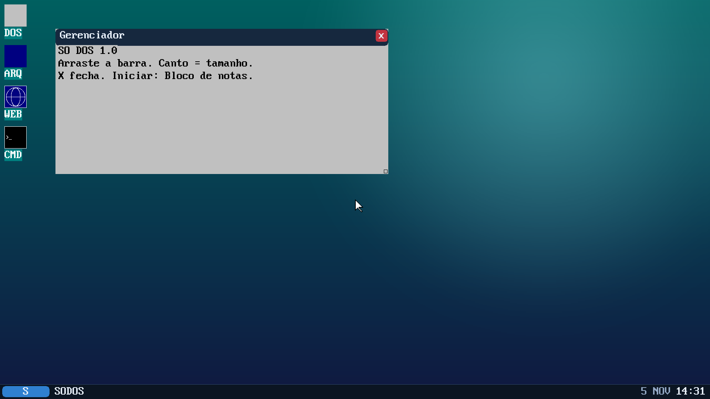
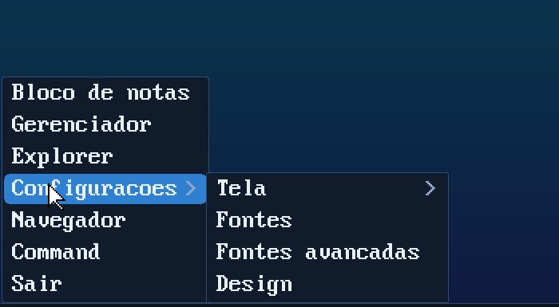
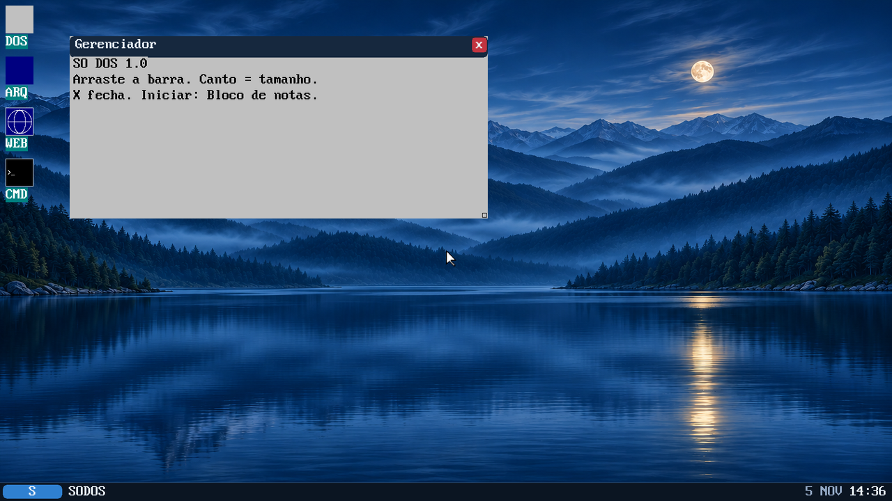
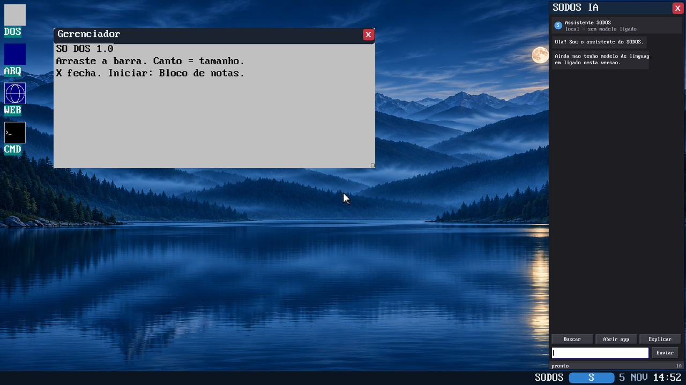

# Interface: tema "vidro escuro"

Redesign do desktop no estilo do mockup aprovado (2026-11): fundo escuro,
cantos arredondados e texto claro sobre paineis. Primeira etapa concluida.





## Cores do tema (`video/visual.c`)

| Constante | Valor | Uso |
|---|---|---|
| `UI_BAR` | `0x0B1522` | barra de tarefas |
| `UI_PANEL` | `0x101C2B` | menu Iniciar, submenu, menu de contexto |
| `UI_TITLE_A` | `0x16283E` | barra de titulo da janela ativa |
| `UI_TITLE_I` | `0x1B2230` | janela sem foco |
| `UI_TEXT` | `0xE8F0FA` | texto principal |
| `UI_DIM` | `0x93A8C4` | texto secundario (data, setas) |
| `UI_ACCENT` | `0x2F80D0` | logo "S", item em destaque |
| `UI_BORDER` | `0x2E4A6C` | contornos de 1px |
| `UI_RADIUS` | `8` | raio dos cantos |

## Funcoes novas

- `fill_rect_a(x,y,w,h,cor,alfa)` — retangulo com mistura alfa sobre o que ja
  esta na tela (alfa 255 = opaco). Usa a mesma convencao de cor do `fill_rect`
  (palavra `PIXA`: `0xFF_BB_GG_RR`).
- `round_rect(x,y,w,h,raio,cor,alfa)` / `fill_round(...)` — cantos arredondados,
  raio em pixels (calculado por arcos de circunferencia, sem tabela).
- `round_frame(...)` — contorno de 1px (sem tocar no miolo).
- `draw_text_t(px,py,texto,cor,escala)` — texto **sem** pintar o fundo do glifo,
  para desenhar sobre vidro/papel de parede. O `draw_string_scaled` antigo pinta
  o fundo (necessario nos apps de console) e continua igual.

## O que ja esta no novo estilo

- **Barra de tarefas**: fundo escuro, botao "S" (abre o menu Iniciar), marca
  `SODOS` e **data/hora** a direita (`rtc_date`/`rtc_time`, mes em portugues).
- **Menu Iniciar**: painel escuro, itens com texto claro, destaque azul
  arredondado no item sob o mouse; submenu (Tela / Fontes / Fontes avancadas /
  Design) no mesmo estilo.
- **Menu de contexto do desktop**: mesmo painel escuro.
- **Barras de titulo**: vidro escuro com cantos de cima arredondados, botao de
  fechar vermelho arredondado, texto claro.

## Roadmap das proximas etapas

1. Icones do desktop (Este computador, Lixeira) com tiles escuros e rotulos
   claros; icones de atalho no padrao novo.
2. Apps no tema escuro por padrao: `wg_theme_use(1)` como padrao no GUI.DLL
   (Explorer, VIDEOCFG, WIDGETS) e `FONTADV` ja e escuro.
3. Botoes minimizar/maximizar de verdade na barra de titulo.
4. Botoes das janelas abertas na barra de tarefas (trocar foco pelo clique).
5. Painel lateral do assistente (como no mockup): por enquanto e so desenho;
   as acoes ("Buscar arquivos", "Abrir aplicativo") podem chamar o
   `k_win_*`/`wm_open_*` que ja existem.
6. ~~Papel de parede oficial do mockup~~: `PICO.PNG` ja esta em
   `content/wallpapers` e vem de fabrica como fundo (ver abaixo).

## Notas de implementacao

- Os paineis hoje sao **opacos** (`fill_round`); a versao translucida depende de
  `fill_rect_a` sobre o papel de parede e ficou para depois — o caminho do alfa
  ja esta pronto e testado em `gui_pixels` (janelas canvas).
- Cores: `gui_col(0xRRGGBB)` converte para a palavra do framebuffer. Duas
  conversoes seguidas (`gui_col` + `rgb_to_pixa`) trocavam R/B — foi o bug que
  deixou os paineis marrons na primeira tentativa.

## Papel de parede PICO

O fundo do mockup (lago, montanhas, lua) esta em
`content/wallpapers/PICO.PNG` (1672x941) e entra em `D:\SODOS\WALLS` pelo
`make disk-files`. O `VIDEOCFG.EXE` linka o **IMGBIG.DLL** em vez do IMG.DLL:

- `IMG.DLL` limita a saida a 800 px de lado (bom para miniaturas e paginas);
- `IMGBIG.DLL` e o mesmo `img.c` compilado com `IMG_MAXS=1920`, entao o papel
  de parede sai em resolucao de tela em vez de borrado.



Como vem de fabrica: `D:\SODOS\VIDEO.CFG` com `mode=1`, `bg=000000` e
`wall=PICO.PNG`, e `D:\SODOS\WALL.RAW` ja escalado para 1920x1080 (o kernel
assim so copia, sem escalar). Escolher outra imagem em **Design** substitui os
dois arquivos.

Escala no kernel: `win_wall_set()` percorre a origem com passo fixo 16.16 (sem
divisao por pixel) — com 1920x1080 isso faz diferenca no boot.

## VIDEO.CFG: as tres opcoes de interface



```
D:\SODOS\VIDEO.CFG
  mode=1          ; 0 retro, 1 avancado (alfa)
  bg=000000       ; cor de fundo quando nao ha imagem
  wall=PICO.PNG   ; imagem de D:\SODOS\WALLS (vazio = so a cor)
  menupos=0       ; posicao do botao "S": 0 esquerda, 1 centro, 2 direita
  glass=1         ; 1 = menu Iniciar translucido
  ia=0            ; 1 = abre o AIPANEL.EXE docado na lateral direita
```

Tudo isso se ajusta na hora em **Design -> Interface** (tres botoes de posicao +
dois checks) e no botao **Aplicar**. O kernel le os mesmos campos no boot
(`win_load_cfg`), entao a escolha sobrevive ao reinicio.

### Posicao do menu

`ui_logo_x()` decide o X do botao "S" e o menu Iniciar nasce logo acima dele
(`start_menu_geom` usa a mesma funcao), inclusive o teste de clique do botao.
Na posicao direita a marca "SODOS" passa para a esquerda do logo.

### Menu translucido

`menu_panel()` desenha o painel com `round_rect(..., alfa = ui_glass ? 215 : 255)`.
O alfa passa pelo `fill_rect_a`, que mistura com o que ja esta na tela (papel de
parede). O destaque azul dos itens tambem e misturado.

### Painel de IA

- `ia=1` faz o laco do WIN executar `D:\SODOS\AIPANEL.EXE` uma vez
  (`ui_ia_launch`, com `gui_raise_title` para nao duplicar).
- O painel usa `gui_dock_open(titulo, largura)` -> `k_gui_dock`: o kernel calcula
  x,y,w,h para encostar na lateral direita, acima da barra.
- Conteudo: cabecalho, historico em bolhas, sugestoes (Buscar / Abrir app /
  Explicar) e campo de mensagem. **Ainda nao ha modelo de linguagem**: as
  respostas sao locais e dizem isso. O layout e o encaixe estao prontos para
  plugar o modelo depois (o `AGENT.EXE`/`LLAMA.EXE` do repositorio e o caminho).
