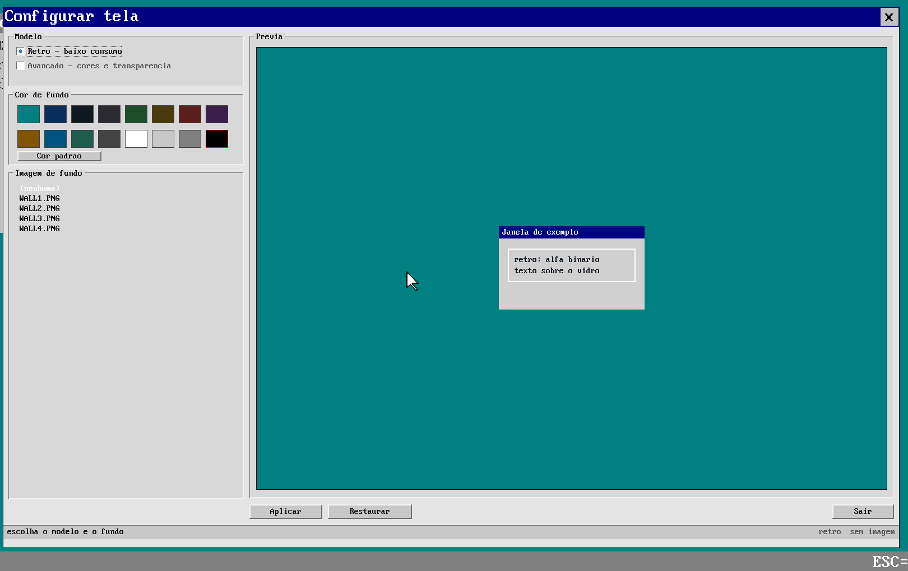
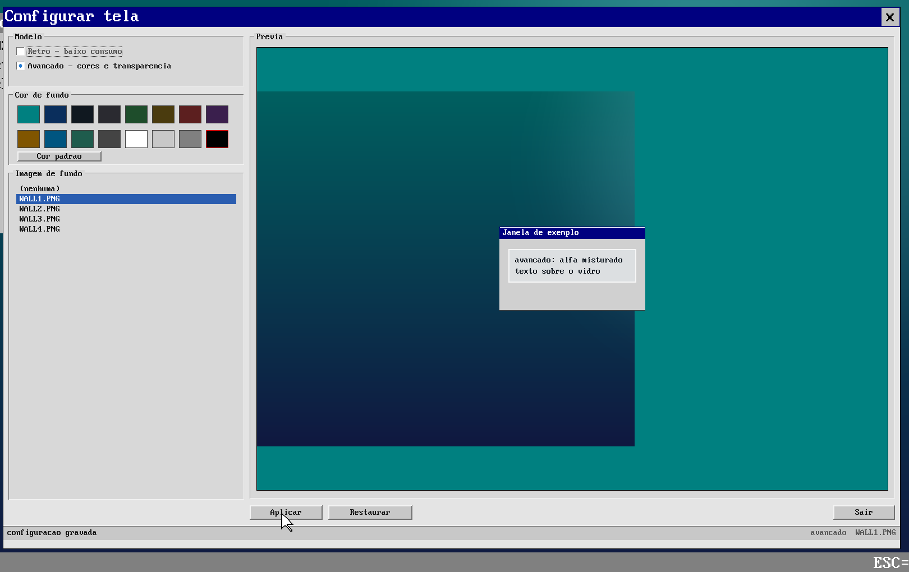
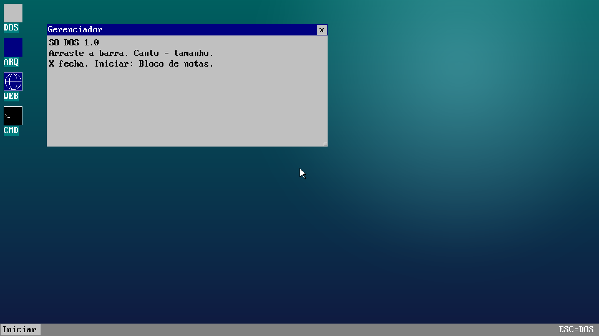
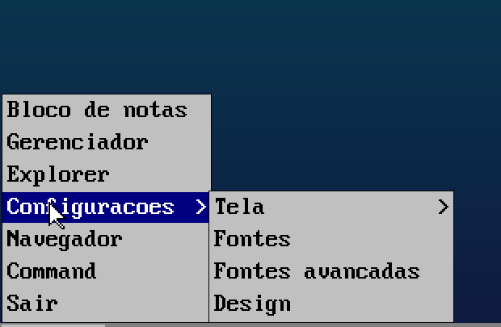

# Video e aparencia do SODOS

O ambiente grafico (WIN) tem dois **modelos de renderizacao** e fundo
configuravel, escolhidos no `VIDEOCFG.EXE`.



## Os dois modelos

| | **Retro** (padrao) | **Avancado** |
|---|---|---|
| Cores | 16.777.216 (framebuffer 32 bpp) | idem |
| Alfa em imagens/TTF | **binario**: `A < 128` nao desenha | **mistura**: `dst = (src*a + dst*(1-a))` |
| Custo por pixel | so teste de alfa | uma multiplicacao/divisao por canal |
| Visual | como sempre foi (bordas duras) | vidro/transparencia suave, sombras |
| Uso | maquinas modestas, VM sem aceleracao | desktop moderno |

O modo vive em `gfx_quality` (`video/visual.c`) e e aplicado em `gui_pixels()`,
que e por onde passam imagens (`gui_image`, `IMG.DLL`), texto TTF
(`fonts/ttfrast.c`) e qualquer RGBA que o app envie.

## Fundo

- **Cor**: 16 amostras na paleta + botao "Cor padrao" (teal `0x008080`).
- **Imagem**: qualquer `.PNG`/`.JPG` em `D:\SODOS\WALLS`. O app decodifica
  (`IMG.DLL`), envia para o kernel e o desktop passa a desenhar a imagem
  escalada para a tela.
- Com imagem, a cor de fundo continua sendo o "reserva" (aparece se a imagem
  nao carregar).



## Como o WIN lembra da configuracao

Ao abrir o desktop, `win_load_cfg()` (`video/visual.c`) le:

```
D:\SODOS\VIDEO.CFG     mode=1
                       bg=000000
                       wall=WALL1.PNG
D:\SODOS\WALL.RAW      "SODW", u16 largura, u16 altura, pixels RGB (3 bytes)
```

- `mode=0` retro, `mode=1` avancado.
- `bg=RRGGBB` cor de fundo (`000000` = padrao).
- `wall=` nome da imagem; se nao estiver vazio, o kernel carrega `WALL.RAW`
  (ja sem depender de decoder de PNG: so copia e escala).

O `VIDEOCFG.EXE` grava os dois arquivos no botao **Aplicar** e aplica na hora
(`k_gui_quality`, `k_win_bg`, `k_win_wallpaper`), entao o efeito aparece antes
mesmo de reiniciar.



## API para programas

```c
int k_gui_quality(int mode);   /* 0 retro, 1 avancado; devolve o anterior */
int k_win_bg(unsigned rgb);    /* 0xRRGGBB; 0 volta ao teal */
int k_win_wallpaper(const void* rgba, int w, int h);  /* NULL limpa */
```

`k_gui_pixels` respeita o modelo: no retro o pixel com alfa < 128 e descartado;
no avancado ele e misturado com o que ja esta na janela. Assim um app pode
desenhar vidro/ sombra sem saber qual modelo esta ativo.

## Nomes 8.3

O FAT do SODOS le apenas nomes curtos: a pasta de papeis de parede e
`D:\SODOS\WALLS` (nao `WALLPAPERS`, que viraria `WALLPA~1` e nao seria
encontrada). As imagens tambem precisam caber em 8.3 (`WALL1.PNG`).

## Driver de placa

Tudo acima e desenho por CPU, e continua sendo o padrao. O driver de placa
(virtio-gpu primeiro) e opcional, vem como `.DLL` e so entra se a placa
existir e passar no teste; sem ele, nada deste documento muda. Veja
[GPU.md](GPU.md).

## Arquivos

- `video/visual.c` — `gfx_quality`, `gfx_desk_clear()`, `gui_pixels()` com
  mistura, `win_load_cfg()`, `win_load_wall()`.
- `utils/video_cfg.c` — o configurador (`VIDEOCFG.EXE`).
- `content/wallpapers/*.PNG` — papeis de parede de exemplo (gerados aqui).
- `kernel/kexports.c` — os tres exports novos.

## Como abrir o configurador

Duas entradas no menu:

- **Iniciar -> Configuracoes -> Design** (ao lado de "Tela" e "Fontes avancadas");
- **botao direito no desktop -> Design** (o menu de contexto tambem tem
  "Console" e "Configuracoes de tela").



O atalho chama `D:\SODOS\VIDEOCFG.EXE` (com fallback para `D:\VIDEOCFG.EXE`,
que e onde o `make disk-files` deixa os .EXE). Se a janela "Configurar tela" ja
estiver aberta, ela so vem para a frente em vez de abrir outra.
