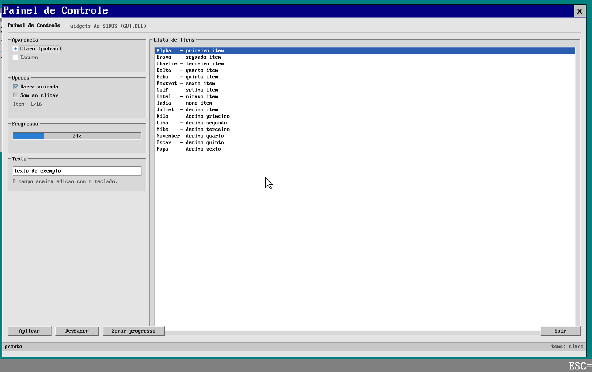
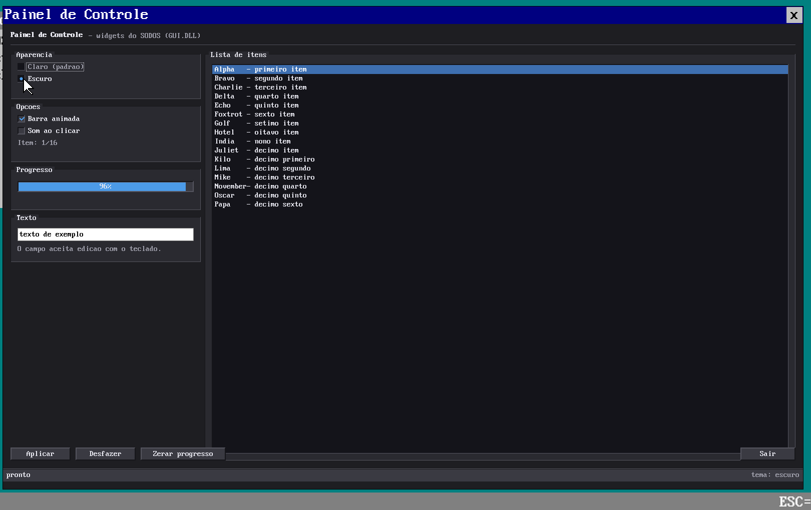

# WIDGETS - controles de interface do SODOS

Biblioteca de controles em user space, dentro da `GUI.DLL`, sobre a janela
canvas do WIN (`k_gui_*`). Serve para qualquer `.EXE` gráfico do sistema.





## Modelo

Estilo *IMGUI*: o app redesenha a janela inteira a cada quadro e os controles
não guardam estado escondido. O que precisa persistir (seleção, texto, foco)
fica em structs do próprio app.

```c
#include <gui.h>
#include <widgets.h>

wg_input(mx, my, down);          /* uma vez por quadro */
gui_fill(0, 0, sw, sh, wg_theme()->bg);
if (wg_button(&meu_id, 16, 16, 120, 26, "Aplicar", 1))
  set_status("aplicado");
wg_progress(16, 60, 300, 22, 42, "42%");
gui_present();
gui_wait(&ev, 50);               /* eventos do WIN */
```

- `wg_input(mx, my, down)`: posição do rato e botão esquerdo. O app atualiza
  isso a partir de `gui_wait()` (`GUI_EV_DOWN/UP/DRAG`).
- Cada controle recebe um `id` (endereço de uma variável serve) e devolve `1`
  no quadro em que foi acionado (aperta e solta dentro).
- `wg_focus_set/get`: foco de teclado; o app faz o Tab andar na lista de ids e
  chama `wg_key_is_activate(k)` para Enter/Espaço.

## Temas

`wg_theme()` devolve o tema atual (`wg_theme_t`: cores e métricas).
`wg_theme_use(0|1)` alterna claro/escuro; `wg_set_theme(&meu_tema)` instala um
tema próprio. Todos os controles leem as cores do tema na hora de desenhar.

## Controles disponíveis

| Função | O que é |
|---|---|
| `wg_button(id,x,y,w,h,label,enabled)` | botão com relevo, foco e estado afundado |
| `wg_toggle(id,...,int* on)` | botão que fica afundado quando `*on` |
| `wg_check(id,x,y,label,int* v)` | caixa de seleção |
| `wg_radio(id,x,y,label,int* v,mine)` | rádio (grupo = mesma `*v`) |
| `wg_progress(x,y,w,h,pct,caption)` | barra de progresso com legenda |
| `wg_scrollbar(id,&wg_scroll_t,x,y,w,h)` | barra com arrasto do thumb |
| `wg_listbox(id,&wg_list_t,x,y,w,h)` | lista com seleção, hover e scrollbar |
| `wg_list_key(&l,key,rows)` | setas/PgUp/PgDn/Home/End na lista |
| `wg_list_wheel(&l,delta,rows)` | roda do rato |
| `wg_edit_box(id,&gui_edit_t,x,y,w,h)` | campo de texto de uma linha |
| `wg_group(x,y,w,h,title)` | caixa com título |
| `wg_status(x,y,w,left,right)` | barra de status |
| `wg_panel`, `wg_bevel`, `wg_separator`, `wg_dot`, `wg_label*` | primitivas |

## Como compilar e rodar

```sh
make -C src13/c_compiler out/GUI.DLL out/WIDGETS.EXE
make -C src13 disk-files          # copia out/*.EXE e out/*.DLL para o D:
```

No SODOS: `Iniciar > Executar > D:\WIDGETS.EXE` (ou, com o WIN aberto,
`curl -X POST --data-binary 'D:\WIDGETS.EXE' http://127.0.0.1:8797/win/execute`).

Para capturar a tela (sem depender de Pillow):

```sh
python3 src13/tools/winshot.py saida.png            # busca /win/printscreen
python3 src13/tools/winshot.py saida.png --crop 230,70,1720,1070
```

## Exemplo completo

[`utils/widgets_demo.c`](../utils/widgets_demo.c) (`WIDGETS.EXE`) usa todos os
controles: grupos, rádios que trocam o tema, checks, progresso animado, lista
com 16 itens, campo de texto, quatro botões e barra de status. Teclado: Tab e
Shift+Tab andam no foco, Enter/Espaço acionam, setas navegam a lista, Esc sai.

## Próximos passos naturais

1. **Texto com TTF** nos controles (hoje é a fonte 8x16 do console): o
   rasterizador já existe em [`fonts/ttfrast.c`](../fonts/ttfrast.c) e é usado
   pelo `FONTADV.EXE`; falta um cache de glifos para desenhar rápido.
2. **Menu e barra de ferramentas** (menu suspenso, atalhos, ícones).
3. **Diálogos** (mensagem, confirmação, abrir/salvar) reaproveitando `wg_*`.
4. **Scrollview**: área com conteúdo maior que a janela (lista + canvas).
5. **Docking / múltiplas janelas** no WIN e foco entre janelas.
