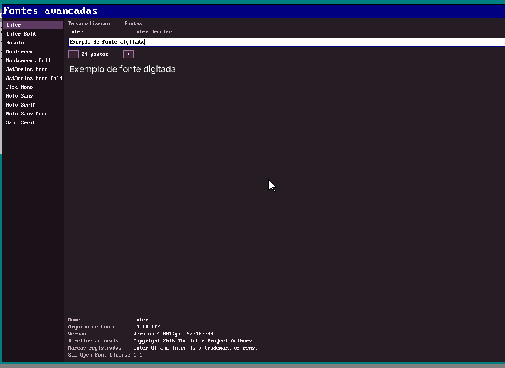

# Fontes do SODOS

Fontes TrueType que o sistema embarca em `D:\SODOS\FONTS` (copiadas por
`make disk-files` a partir de `fonts/ship/`).

Todas são **gratuitas para uso comercial**, com licença que permite
redistribuição (SIL Open Font License 1.1 ou Apache 2.0). Os textos completos
estão em [`licenses/`](licenses/).



## Conjunto atual

| Família | Peso | Arquivo no SODOS | Licença | Origem |
|---|---|---|---|---|
| **Inter** | Regular | `INTER.TTF` | OFL 1.1 | [rsms/inter](https://github.com/rsms/inter) v4.1 (`extras/ttf`) |
| **Inter** | Bold | `INTERBD.TTF` | OFL 1.1 | idem |
| **Roboto** | Regular | `ROBOTO.TTF` | Apache 2.0 | [googlefonts/roboto-2](https://github.com/googlefonts/roboto-2) |
| **Montserrat** | Regular | `MONTSR.TTF` | OFL 1.1 | [JulietaUla/Montserrat](https://github.com/JulietaUla/Montserrat) |
| **Montserrat** | Bold | `MONTSBD.TTF` | OFL 1.1 | idem |
| **JetBrains Mono** | Regular | `JBMONO.TTF` | OFL 1.1 | [JetBrains/JetBrainsMono](https://github.com/JetBrains/JetBrainsMono) |
| **JetBrains Mono** | Bold | `JBMONBD.TTF` | OFL 1.1 | idem |
| **Fira Mono** | Regular | `FIRAMON.TTF` | OFL 1.1 | [google/fonts](https://github.com/google/fonts/tree/main/ofl/firamono) |
| Noto Sans | Regular | `NOTOSANS.TTF` | OFL 1.1 | [google/fonts](https://github.com/google/fonts/tree/main/ofl/notosans) |
| Noto Serif | Regular | `NOTOSERF.TTF` | OFL 1.1 | idem |
| Noto Sans Mono | Regular | `NOTOMONO.TTF` | OFL 1.1 | idem |
| Sans Serif (coleta) | Regular | `SANSCOLL.TTF` | OFL 1.1 | idem |

As quatro últimas já existiam no repositório (`fonts/ship/`, `OFL.TXT`).

### Para que serve cada uma

- **Inter** — interface (texto de UI em 11–16 px). Desenhada para telas, boa
  legibilidade em tamanho pequeno.
- **Roboto** — alternativa de UI no estilo Android/Chrome; licença Apache 2.0.
- **Montserrat** — títulos e cabeçalhos (geométrica, larga).
- **JetBrains Mono** — código/terminal (monoespaçada, altura de x grande).
- **Fira Mono** — segunda monoespaçada, mais estreita.

## Nomes 8.3

O FAT do SODOS trabalha com nomes curtos, então os arquivos em `fonts/ship/`
usam o padrão 8.3 (`INTER.TTF`, `MONTSBD.TTF`, ...). O nome real da família
está dentro do TTF e é o que o `FONTADV.EXE` mostra.

## Como usar

No SODOS: **Iniciar → Executar → `D:\SODOS\FONTADV.EXE`**. O visualizador lista
as 12 faces, mostra o nome/versão/copyright e desenha uma frase no tamanho
escolhido (os botões `-`/`+` mudam o corpo). A licença de cada face aparece no
rodapé.

No código, `fonts/ttfrast.c` rasteriza a frase:

```c
#include "ttfrast.h"
ttf_phrase(ttf_bytes, ttf_len, "Exemplo", 24,
           &rgba, &w, &h, name, sizeof name, full, sizeof full,
           ver, sizeof ver, copy, sizeof copy,
           tm, sizeof tm);
```

## Como atualizar/adicionar

1. Baixe um TTF **estático** (o rasterizador do SODOS lê contornos `glyf`;
   fontes variáveis também abrem, mas ficam no peso padrão).
2. Confirme a licença e guarde o texto em `fonts/licenses/`.
3. Copie para `fonts/ship/` com nome 8.3 em maiúsculas.
4. Acrescente a face em `fonts/fontadv.c` (`paths`, `labels`, `files`,
   `licenses`) para ela aparecer no visualizador.
5. `make -C src13/c_compiler out/FONTADV.EXE` e, com o QEMU fechado,
   `make -C src13 disk-files`.
